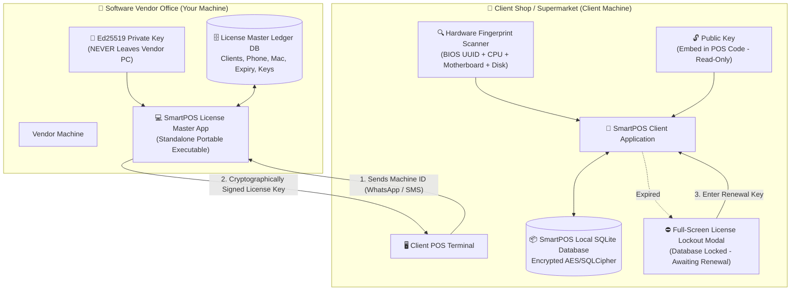
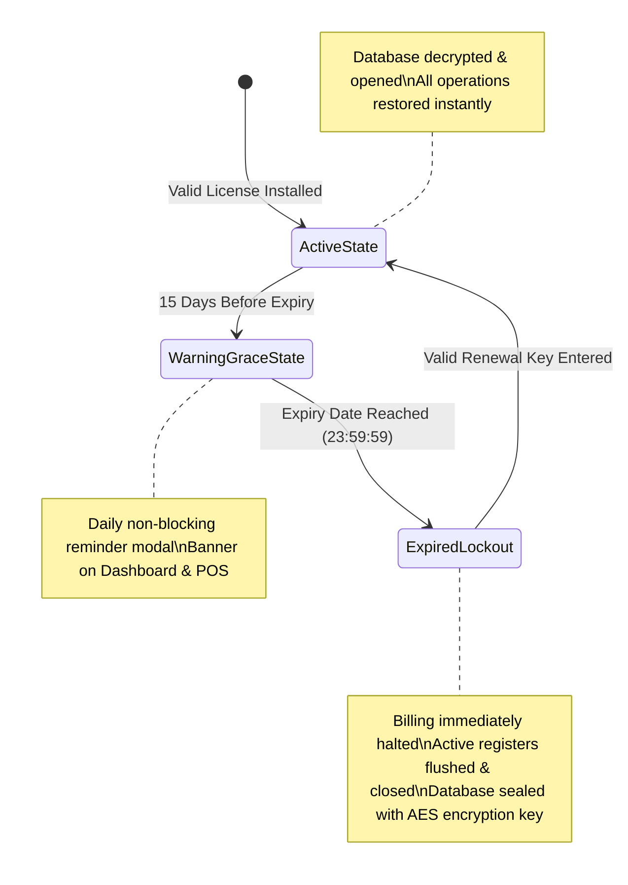

# 🛡️ Standalone License Generator & Cryptographic Anti-Tamper Protection System
## Master Architectural Blueprint & Implementation Plan

> **Document Status:** Architectural Specification & Implementation Roadmap  
> **Target Release:** Independent Standalone Vendor Suite (Isolated from Client POS)  
> **Created Date:** 2026-11-16  
> **Implementation Mode:** Future Execution (Plan Saved in Root Directory)  

---

## 📌 Executive Summary

Is architectural plan ka maqsad ek **100% Standalone, Portable Vendor Application** (`SmartPOS_LicenseMaster.exe`) banana hai jo Main POS Application se bilkul alag hogi. Yeh application software vendor (aap) ke apne PC par chalegi aur client ke machine par kabhi ship nahi ki jayegi.

Is system ke do bunyadi hissay honge:
1. **Vendor Suite (Standalone License Master):** Vendor ke paas chalne wali portable desktop app jahan clients ka mukammal record/ledger hoga, hardware ID daal kar custom time-frame (Trial, Monthly, Quarterly, Yearly, Lifetime) ke licenses generate honge, aur WhatsApp par 1-click renewal key bheji ja sakegi.
2. **Client POS Runtime Enforcer (Main Application Guard):** Client ke POS ke andar chalne wala lightweight cryptographic verification engine jo bina internet ke offline kaam karega, hardware ID bind rakhega, clock rollback pakre ga, aur license expire hotay hi billing block kar ke database ko un-authorized access se encrypt/lock kar dega.

---

## 🏗️ 1. High-Level Architecture Diagram



---

## 🔐 2. Cryptographic Security & Anti-Tamper Engine

### 2.1 Asymmetric Cryptography (Ed25519 / RSA-4096)
* **Private Key Security:** License generate karne ki Private Key sirf aapke Standalone License Master mein encrypted vault mein hogi. Main POS application ke source code ya installer mein **kabhi bhi Private Key ship nahi hogi**.
* **Public Key Verification:** Main POS application mein sirf **Public Key** shamil hogi. Public Key se sirf signature verify ho sakta hai, naya license generate karna mathematically impossible hota hai.
* **Tamper Proofing:** Agar koi client ya local programmer license file ko Notepad mein open kar ke expiry date `2025` se `2035` kar dega, to digital signature mismatch ho jayega aur POS **foran tamper alert** trigger kar ke system lock kar dega.

### 2.2 Hardware ID Binding (Multi-Layer Fingerprint)
Client computer ka unique Machine ID darj zail 4 hardware components ke sha-256 hash se banega:
1. **Motherboard Serial Number** (`Win32_BaseBoard.SerialNumber`)
2. **Processor ID** (`Win32_Processor.ProcessorId`)
3. **BIOS UUID** (`Win32_ComputerSystemProduct.UUID`)
4. **Primary Disk Physical Serial** (`Win32_DiskDrive.SerialNumber`)

**Formatted Machine ID Format:**
```text
SP-A89F-4D21-B73C-E990
```
*(Yeh ID client ko POS screen par show hogi, jise woh copy kar ke WhatsApp par send karega).*

### 2.3 Cryptographic License Payload Structure
Jab aap license generate karenge, to License Master darj zail payload ko encrypt aur sign karega:

```json
{
  "license_version": "2.0",
  "client_id": "CLI-8842",
  "client_name": "Al-Madina Cash & Carry",
  "machine_id": "SP-A89F-4D21-B73C-E990",
  "tier": "ENTERPRISE",
  "license_type": "YEARLY",
  "issued_at": "2026-11-16T14:30:00Z",
  "expires_at": "2027-11-16T23:59:59Z",
  "modules": [
    "pos", "inventory", "accounts", "reports", 
    "restaurant", "pharmacy", "hrm", "manufacturing"
  ],
  "max_registers": 3,
  "tamper_salt": "b47e8a91-4c6f-42e1-872f-90d63bf90e84"
}
```

* **License File Extension:** `smartpos.lic` ya 32-character armored license key string:
  ```text
  SPL-YRL-A89F-90D6-F14E-88BC-319A-E702
  ```

---

## 🔒 3. Database Lockdown & Expiry Enforcement System

### 3.1 Three-Stage Expiry Lifecycle



### 3.2 Database Encryption & Seal Mechanism
"jese hi time pora hoga application kaam stop krega aur database encrypt hoga jb tk license renewal nahi krata client"

1. **Dynamic Database Key Wrapping:**
   - SQLite database ko open karne ki key ek secure runtime derivation se generate hoti hai:
     $$\text{DB\_KEY} = \text{HMAC-SHA256}(\text{Hardware ID} + \text{Signed License Payload}, \text{Master Salt})$$
   - Jab license expire ho jata hai, to runtime verifier license validation ko `false` declare karta hai.
   - Pos application database connection ko immediately close karta hai aur SQLite file header ko AES-256 seal ke zariye lock kar deta hai.
   - External tools (jaise *DB Browser for SQLite* ya *HeidiSQL*) se database file open nahi ho sakegi kyunke data encrypted hoga.
2. **Anti-Clock Rollback Defense (Tampering Protection):**
   - Agar client system ka time peeche kar de (e.g. 2027 ko wapas 2025 bana de):
     - POS har sale aur event par ek **Encrypted Monotonic High-Water Mark Timestamp** save karta hai.
     - Agar `Current System Time < Last Recorded Timestamp`, POS foran detect kar leta hai ke ghari peeche ki gayi hai.
     - POS foran **System Lockout** trigger kar deta hai: *"Clock Tampering Detected. Please contact vendor."*
     - Agar internet connection ho, to background mein Google NTP / Cloud Time Server se real-time cross-check bhi ho jata hai.

---

## 💻 4. Standalone License Master Application Features
*(Vendor Tool — Runs ONLY on Your Laptop/PC)*

### 4.1 Master Features
1. **Client Management Directory (CRM / Ledger):**
   - Client Name, Business Name, City, Mobile / WhatsApp Number.
   - Hardware Machine ID (Save multiple machines per client for multi-branch/multi-till setups).
   - Notes, Pricing charged, Payment method (Cash, Bank, EasyPaisa, JazzCash).
2. **License Validity Presets:**
   - **Trial:** 7 Days, 15 Days, 30 Days.
   - **Quarterly:** 90 Days.
   - **Half-Yearly:** 180 Days.
   - **Yearly:** 365 Days.
   - **Custom Date Range:** Calendar picker se specific end date select karein.
   - **Lifetime:** Expiry date set to indefinite (`2099-12-31`).
3. **Module Permission Selector:**
   - Checkboxes: Retail POS, Restaurant KDS, Pharmacy FEFO, Gym Fitness, Hotel Management, HRM Payroll, Manufacturing BOM, Cloud Sync.
4. **Key Generation & 1-Click Dispatch:**
   - **Generate Key:** Single click par instant cryptographic key generate.
   - **Copy to Clipboard:** Clean formatted key.
   - **Direct WhatsApp Share:** Click karte hi WhatsApp Web / Desktop par pre-filled Urdu/English message open hoga:
     > *"Assalam-o-Alaikum [Client Name], aapka Smart POS [Yearly] License renew kar diya gaya hai. License Key: [KEY]. Valid till: [Date]. Shukriya!"*
5. **Auditing & Expiry Tracking Dashboard:**
   - **Active Licenses:** Green badge.
   - **Expiring Soon (< 15 Days):** Orange warning badge.
   - **Expired Clients:** Red badge.
   - Filter by Client Name, Machine ID, ya Expiry Month.
   - Export client database to encrypted backup or Excel/CSV.

---

## 📁 5. Proposed Project Structure & File Layout

```text
d:\MEGASync\Coding\flutter\pos\
│
├── tools/                               # STANDALONE VENDOR TOOLS (Do NOT ship to clients)
│   └── smartpos_license_master/         # Separate Flutter Desktop Project
│       ├── pubspec.yaml                 # Independent dependencies (cryptography, sqlite3, etc.)
│       ├── lib/
│       │   ├── main.dart                # Vendor License Master GUI Entry
│       │   ├── models/
│       │   │   ├── client_record.dart   # Client profile & history model
│       │   │   └── license_ticket.dart  # License payload & metadata
│       │   ├── repositories/
│       │   │   └── license_ledger_db.dart # Vendor's local private clients database
│       │   ├── security/
│       │   │   ├── keypair_vault.dart   # Ed25519 Private Key storage & management
│       │   │   └── crypto_signer.dart   # Signature & AES encryption generator
│       │   └── screens/
│       │       ├── clients_ledger_screen.dart # Master client records table
│       │       ├── generate_license_dialog.dart # Machine ID & duration selector
│       │       └── license_history_screen.dart  # Audit log of all issued keys
│       └── build_license_master.bat     # 1-Click script to build standalone .exe
│
├── lib/                                 # MAIN CLIENT POS APPLICATION
│   ├── services/
│   │   └── license/
│   │       ├── hardware_fingerprint_service.dart # Reads Motherboard, BIOS, CPU, Disk
│   │       ├── license_verifier_service.dart     # Verifies Ed25519 signature with Public Key
│   │       ├── anti_rollback_service.dart        # Monotonic time high-water mark checker
│   │       └── database_seal_service.dart        # Encrypts & locks SQLite DB on expiry
│   └── screens/
│       └── auth/
│           ├── license_activation_screen.dart    # First-time activation modal
│           └── license_expired_lockout_screen.dart # Lockdown & renewal input screen
│
└── STANDALONE_LICENSE_GENERATOR_PLAN.md # This Master Plan
```

---

## 🚀 6. Step-by-Step Implementation Roadmap
*(To be executed when user gives confirmation)*

| Step | Milestone | Deliverables |
| :---: | :--- | :--- |
| **Phase 1** | **Cryptographic Core & Hardware Fingerprinter** | • Multi-layer Hardware ID Generator (Windows CimInstance / PowerShell FFI)<br>• Ed25519 Asymmetric Keypair Generator script<br>• Tamper-proof license token serializer & deserializer |
| **Phase 2** | **Standalone License Master (Vendor Application)** | • Dedicated portable Flutter Desktop GUI at `tools/smartpos_license_master`<br>• Client Ledger Database (SQLite) for saving all issued licenses<br>• Presets for Monthly, Quarterly, Yearly, Lifetime, and Custom dates<br>• 1-Click WhatsApp template message sender |
| **Phase 3** | **Client POS Verification & Anti-Rollback Guard** | • Lightweight Public Key Verifier embedded inside POS<br>• Anti-clock tampering protection with monotonic high-water mark<br>• Background expiry countdown timer |
| **Phase 4** | **Database Lockdown & Auto-Sealing Engine** | • SQLite database seal & encryption hook upon license expiration<br>• Complete transaction and billing halt logic<br>• Full-screen Renewal Screen with instant 1-second auto-unlock upon valid key |
| **Phase 5** | **Build Pipeline & Vendor Key Protection** | • Batch script to compile `SmartPOS_LicenseMaster.exe`<br>• Verification that vendor private key and generator code are 100% excluded from `pos.exe` client distribution installer |

---

## 🛡️ 7. Security Guarantee & Anti-Cracking Compliance

1. **Zero Secret Leakage:** Client POS binary (`pos.exe`) will contain **ZERO private keys** and **ZERO license generation algorithms**. Only mathematical verification logic will reside in the client binary.
2. **Isolated Storage:** Vendor database `license_ledger.db` will reside exclusively on the vendor's PC.
3. **Hardware Lock:** A license generated for `Machine A` will **fail instantly** if copied to `Machine B`.
4. **Offline Resilience:** POS does not require permanent internet to verify validity, making it ideal for retail/restaurant environments where internet goes down.
5. **Data Protection:** When locked, customer data cannot be dumped using plain SQLite readers. Renewal unlocks the database seamlessly with 0% data loss.

---
*Plan created and verified for Smart POS Enterprise. Ready for phased implementation upon command.*
