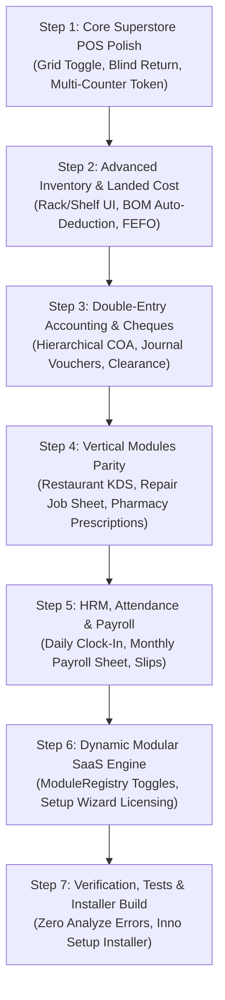

# ULTIMATEPOS VS SMARTPOS: COMPREHENSIVE MODULE-BY-MODULE AUDIT, GAP ANALYSIS & UPGRADE PLAN

> **Document Version:** 1.0.0 Enterprise Master Blueprint  
> **Date:** November 13, 2026  
> **Target Application:** SmartPOS (Flutter Desktop / Android / Web / Local Offline-First)  
> **Reference Benchmark:** UltimatePOS v5.x (PHP 8.1 / Laravel / MySQL / AdminLTE)  
> **Target Deployment Root:** `d:\MEGASync\Coding\flutter\pos`  
> **UltimatePOS Source Path:** `C:\laragon\www\ultimate-pos` (`http://ultimate-pos.test`)

---

## TABLE OF CONTENTS
1. [Executive Summary & Strategic Vision](#1-executive-summary--strategic-vision)
2. [Global Architectural Comparison (UltimatePOS vs SmartPOS)](#2-global-architectural-comparison)
3. [Master Module Inventory Matrix](#3-master-module-inventory-matrix)
4. [Module-by-Module In-Depth Audit & Gap Analysis](#4-module-by-module-in-depth-audit--gap-analysis)
   - [Module 01: POS Terminal & Checkout Engine](#module-01-pos-terminal--checkout-engine)
   - [Module 02: Products & Inventory Management](#module-02-products--inventory-management)
   - [Module 03: Purchases & Supplier Management](#module-03-purchases--supplier-management)
   - [Module 04: Sales, Orders, Drafts & Quotations](#module-04-sales-orders-drafts--quotations)
   - [Module 05: Sales Returns & Purchase Returns (Including Blind Returns)](#module-05-sales-returns--purchase-returns)
   - [Module 06: Stock Transfers & Stock Adjustments](#module-06-stock-transfers--stock-adjustments)
   - [Module 07: Contacts & CRM (Customers, Suppliers, Khata & Ledgers)](#module-07-contacts--crm)
   - [Module 08: Double-Entry Accounting, Banking & Cheque Management](#module-08-double-entry-accounting-banking--cheque-management)
   - [Module 09: Cash Register & Shift Reconciliation](#module-09-cash-register--shift-reconciliation)
   - [Module 10: Restaurant, Cafe & Kitchen Display System (KDS)](#module-10-restaurant-cafe--kitchen-display-system-kds)
   - [Module 11: Repair & Service Center Management](#module-11-repair--service-center-management)
   - [Module 12: Pharmacy & Healthcare (Drug Act, Expiry & Batches)](#module-12-pharmacy--healthcare)
   - [Module 13: Hotel & Room Reservation Management](#module-13-hotel--room-reservation-management)
   - [Module 14: Gym & Fitness Club Management](#module-14-gym--fitness-club-management)
   - [Module 15: Manufacturing, BOM & Assembly Production](#module-15-manufacturing-bom--assembly-production)
   - [Module 16: HRM, Staff Attendance & Payroll (Essentials)](#module-16-hrm-staff-attendance--payroll)
   - [Module 17: Multi-Location, Warehouses & Branch Synchronization](#module-17-multi-location-warehouses--branch-synchronization)
   - [Module 18: Barcode Label Designer & Printing Engine](#module-18-barcode-label-designer--printing-engine)
   - [Module 19: Reports & Business Intelligence Engine](#module-19-reports--business-intelligence-engine)
   - [Module 20: User Management, Roles & Granular RBAC Permissions](#module-20-user-management-roles--granular-rbac-permissions)
   - [Module 21: Communication Gateways (SMS, WhatsApp & Notifications)](#module-21-communication-gateways-sms-whatsapp--notifications)
   - [Module 22: Settings, Layouts & Fiscal Compliance (FBR/ZATCA/Tax)](#module-22-settings-layouts--fiscal-compliance)
5. [Multi-Counter Superstore Enterprise Architecture (10+ Counters Real-Time Flow)](#5-multi-counter-superstore-enterprise-architecture)
6. [Dynamic Modular SaaS Architecture (Feature Toggles & Client Monetization)](#6-dynamic-modular-saas-architecture)
7. [Step-by-Step Implementation Roadmap](#7-step-by-step-implementation-roadmap)

---

## 1. EXECUTIVE SUMMARY & STRATEGIC VISION

### The Objective
To elevate **SmartPOS** from a functional multi-industry Flutter POS into a market-dominant, high-performance, offline-first enterprise retail suite that:
1. **Attains 100% Feature Parity** with the industry benchmark **UltimatePOS** across all 22 operational modules.
2. **Surpasses UltimatePOS** in execution speed (sub-millisecond local SQLite queries vs multi-second Laravel web page reloads), offline independence (zero internet requirement), modern desktop ergonomic UX, hardware integration (ESC/POS thermal printers, barcode scales, customer pole displays), and real-time LAN multi-counter orchestration.
3. **Implements Pure Modular Monetization**: Every non-core business module (Restaurant, Pharmacy, Repair, Hotel, Gym, Manufacturing, HRM, Accounting, Multi-Location) can be dynamically toggled ON/OFF during setup or from the admin panel, allowing tiered licensing (Starter, Standard, Pro, Enterprise) where clients only pay for the exact features they activate.

```
       ┌─────────────────────────────────────────────────────────────┐
       │                   SMARTPOS ENTERPRISE                       │
       │        Flutter Native UI + High-Speed Local SQLite          │
       ├──────────────────────────────┬──────────────────────────────┤
       │     Core Modules (Always)    │   Optional Dynamic Modules   │
       │  - POS Terminal & Cash Till  │  - Restaurant KDS & Modifiers│
       │  - Catalog & Multi-Unit Stock│  - Pharmacy Expiry & Form 2A │
       │  - Sales, Drafts & Quotes    │  - Repair & Service Center   │
       │  - Purchases & Expenses      │  - Double-Entry Accounting   │
       │  - Customer & Supplier Khata │  - HRM & Staff Payroll       │
       │  - ESC/POS & Universal Print │  - Manufacturing & BOM       │
       │  - User Roles & Audit Trail  │  - Gym / Hotel / Mandi / Agri│
       └──────────────────────────────┴──────────────────────────────┘
                                     │
                     ┌───────────────┴───────────────┐
                     │ Multi-Counter LAN Fast Socket │
                     │   + Background Cloud Sync     │
                     └───────────────────────────────┘
```

---

## 2. GLOBAL ARCHITECTURAL COMPARISON

| Dimension | UltimatePOS (Laravel Benchmark) | SmartPOS (Our Flutter Solution) | Architectural Verdict & Advantage |
|---|---|---|---|
| **Runtime & Tech Stack** | PHP 8.1 + Laravel Framework + Blade Templates + jQuery + DataTables | Flutter 3.33+ (Dart Ahead-Of-Time compiled) + Riverpod 2.6 | **SmartPOS Advantage:** Native 60-120 FPS desktop rendering, zero browser overhead, instantaneous screen transitions. |
| **Database Architecture** | Centralized MySQL / MariaDB (Requires active network connection or local Laragon/XAMPP daemon) | Hybrid Offline-First: Local SQLite (Encrypted AES-256-GCM) + Remote MySQL / Cloud Sync via Sync Queue | **SmartPOS Advantage:** Unbreakable offline continuity. Counter works 100% even if network cable is unplugged. |
| **POS Checkout Speed** | Web page form submission with AJAX table reloading (~500ms - 2000ms latency) | Local memory reactive state (`CartNotifier`), instant sub-millisecond barcode scanning | **SmartPOS Advantage:** Capable of handling high-traffic hypermarket rush hours (15+ items scanned per second). |
| **Multi-Counter LAN Communication** | Central MySQL database polling or Pusher webhooks | Local SQLite + Background MySQL sync + **(Planned LAN Socket Broker for sub-100ms real-time multi-counter sync)** | Needs LAN Real-Time Broker implementation to exceed UltimatePOS. |
| **Hardware Peripherals** | Relies on browser print dialog, QZ Tray, or raw socket helper plugins | Direct ESC/POS byte streaming via TCP/IP Network, USB RAW, Windows Spooler, Bluetooth | **SmartPOS Advantage:** Zero driver friction, auto-cut, cash drawer kick pulse without print prompt. |
| **Language & Localization** | Standard Laravel gettext/lang files | Strict Dual Hierarchy (`PosLocalization`): Pure Single Primary Language when non-English; Optional Bilingual when English | **SmartPOS Advantage:** No English clutter on Urdu/Farsi/Arabic receipts and screens. |
| **Modularity & Licensing** | `modules_statuses.json` with Laravel service providers | Dynamic `ModuleRegistry` + `business_settings.modules_enabled` JSON bitmask + dynamic sidebar navigation | **SmartPOS Strategy:** Clean toggle system directly mapped to SaaS subscription keys. |

---

## 3. MASTER MODULE INVENTORY MATRIX

| # | Module Name | UltimatePOS Status | SmartPOS Current Status | Gap / Completeness | Priority |
|---|---|---|---|---|---|
| **01** | **POS Terminal & Checkout** | Full | 85% Functional | Missing: LAN counter sync, barcode scale parsing, POS grid toggle | **P0 (Critical)** |
| **02** | **Products & Inventory** | Full | 80% Functional | Missing: Opening stock import batch, shelf/rack UI, auto-combo deduction | **P0 (Critical)** |
| **03** | **Purchases & Suppliers** | Full | 75% Functional | Missing: Purchase order to purchase 1-click convert, landed cost allocation | **P1 (High)** |
| **04** | **Sales & Quotations** | Full | 85% Functional | Missing: Recurring invoices / subscriptions, packing slip PDF generator | **P1 (High)** |
| **05** | **Sales & Purchase Returns** | Full | 70% Functional | **Critical Gap:** Blind return (return without prior invoice) missing | **P0 (Critical)** |
| **06** | **Stock Transfers & Adjustments** | Full | 75% Functional | Missing: Transfer in-transit status & branch verification, normal/abnormal waste | **P1 (High)** |
| **07** | **Contacts & Khata (CRM)** | Full | 85% Functional | Missing: Customer credit limit hard block, automated aging buckets | **P1 (High)** |
| **08** | **Double-Entry Accounting & Cheques** | Full | 70% Functional | Missing: Full 4-tier Chart of Accounts, manual JV entry, cheque bounce lifecycle | **P0 (Critical)** |
| **09** | **Cash Register & Shift Till** | Full | 90% Functional | Missing: Physical cash denomination count breakdown on shift close | **P1 (High)** |
| **10** | **Restaurant & Kitchen (KDS)** | Full | 65% Functional | Missing: Live color-coded KDS screen, modifiers set pricing, table bill split | **P1 (High)** |
| **11** | **Repair & Service Center** | Full | 60% Functional | Missing: Job sheet printable voucher, defect checklist, spare parts deduction | **P1 (High)** |
| **12** | **Pharmacy & Healthcare** | Partial | 75% Functional | Missing: Form 2A warranty print, narcotic sale doctor prescription validation | **P1 (High)** |
| **13** | **Hotel & Lodging** | Addon | 50% Functional | Missing: Room reservation calendar view, check-in folio billing | **P2 (Medium)** |
| **14** | **Gym & Fitness** | Addon | 50% Functional | Missing: Membership expiry reminder automation, trainer assignment | **P2 (Medium)** |
| **15** | **Manufacturing & BOM** | Addon | 45% Functional | Missing: Production runs, raw material wastage tracking, finished goods cost | **P2 (Medium)** |
| **16** | **HRM, Attendance & Payroll** | Full | 40% Functional | Missing: Daily check-in/out attendance, monthly payroll sheet, allowances | **P1 (High)** |
| **17** | **Multi-Location & Warehouses** | Full | 70% Functional | Missing: Location-specific default selling price group & invoice scheme | **P1 (High)** |
| **18** | **Barcode Designer & Labels** | Full | 80% Functional | Missing: Custom visual label designer with draggable barcode/price/logo blocks | **P2 (Medium)** |
| **19** | **Reports & Analytics** | Full | 80% Functional | Missing: Trending products chart, register shift audit report, tax return CSV | **P1 (High)** |
| **20** | **User Roles & Granular RBAC** | Full | 85% Functional | Missing: Restrict user to specific contacts / view own sales only enforcement | **P1 (High)** |
| **21** | **Notifications & Communication** | Full | 80% Functional | Missing: Automated SMS/WhatsApp trigger on sale completion via webhook | **P2 (Medium)** |
| **22** | **Settings & Fiscal Compliance** | Full | 85% Functional | Missing: Modular feature toggle registry UI, ZATCA / FBR QR compliance | **P0 (Critical)** |

---

## 4. MODULE-BY-MODULE IN-DEPTH AUDIT & GAP ANALYSIS

### Module 01: POS Terminal & Checkout Engine
* **UltimatePOS Capabilities:**
  - High-speed POS interface with Category and Brand filters.
  - Draft, Quotation, Suspend (Hold) bills with customer name tag.
  - Multi-payment types (Cash, Card, Cheque, Bank Transfer, Custom, Dual Tender).
  - Cash denomination calculator on cash tender modal.
  - Multiple types of service (Dine-in, Takeaway, Home Delivery, Third-Party delivery apps).
  - Weighing scale barcode integration (`20XXXXXWWWWWC` where weight is encoded in the barcode).
* **SmartPOS Current State:**
  - Fast keyboard-driven POS terminal (`F1` to `F12` hotkeys).
  - Drafts, Quotations, Parked Sales, Split Tender, Multi-Currency exchange (PKR, USD, AED, SAR).
  - ESC/POS thermal printing (80mm & 58mm) with auto-cut and cash drawer kick.
  - Urdu/English dual number-to-words receipt total.
* **Incomplete Features & Critical Issues in SmartPOS:**
  1. **Product Grid Space Waste (User Issue #7):** In supermarket mode, cashier uses barcode scanners only. Having the product grid visible eats up 50% of the screen. Setting must allow toggling POS Product Grid ON/OFF to give full screen width to Cart & Totals.
  2. **Weighing Scale Barcode Reader:** Scanning meat/vegetable/fruit barcode where digits 8-12 represent weight (e.g. `2000145012503` = Product 145, Weight 1.250 kg) does not automatically parse quantity into cart.
  3. **Multi-Counter Token to Payment Counter Flow:** A salesman counter generating a bill token cannot currently be instantly pulled up at the central cash counter by scanning the token barcode.
  4. **Rapid Barcode Scanner Key-drop:** Scanning barcodes consecutively without pause can occasionally drop digits if input focus is lost.
* **Action Items to Upgrade:**
  - [ ] Add `enable_pos_product_grid` setting in `pos_settings` with instantaneous toggle switch on POS top bar.
  - [ ] Implement `WeighingScaleBarcodeParser` utility supporting EAN-13 price-embedded and weight-embedded barcodes.
  - [ ] Implement Bill Token workflow: `Suspend as Token Bill` -> Generates small receipt with Barcode -> Payment Counter scans barcode to recall cart instantly.

---

### Module 02: Products & Inventory Management
* **UltimatePOS Capabilities:**
  - Single, Variable, and Combo (Kit/Bundle) products.
  - Multi-unit conversions with sub-unit multipliers (e.g., 1 Box = 10 Strips = 100 Tablets).
  - Product racks, rows, and shelf locations per warehouse location.
  - Opening stock bulk import via Excel/CSV with location and batch allocation.
  - Selling price groups (Wholesale, Retail, Minimum Price, Distributor).
  - Automatic low stock and out-of-stock notification triggers.
  - Warranty tracking (Days, Months, Years with description).
* **SmartPOS Current State:**
  - Products catalog with single, variable, and bundle models.
  - Category, Brand, Unit, Variation Template, Selling Price Groups.
  - Image uploading, SKU auto-generation, low stock badges.
* **Incomplete Features & Critical Issues in SmartPOS:**
  1. **Rack/Shelf Location Missing in UI:** While `product_racks` table exists in database schema, there are no fields in `add_product_screen.dart` to specify Rack/Row/Shelf, making warehouse picking impossible for large stores.
  2. **Combo / Bundle Stock Auto-Deduction:** Selling a bundle currently treats the bundle as a single line without atomically deducting the underlying component items from inventory!
  3. **Bulk Opening Stock Import:** No dedicated opening stock import wizard with batch/expiry dates.
  4. **Product Stock History Ledger:** Missing a dedicated tab showing all movements for a single product (Purchases, Sales, Returns, Adjustments, Transfers) in a running ledger format.
* **Action Items to Upgrade:**
  - [ ] Add Rack, Row, Position fields in `add_product_screen.dart` and `products_list_screen.dart`.
  - [ ] Update `CartNotifier` and checkout transaction logic to atomically deduct bundled items when a combo product is sold.
  - [ ] Build `ProductStockHistoryScreen` showing comprehensive audit log of every stock movement for any selected product.

---

### Module 03: Purchases & Supplier Management
* **UltimatePOS Capabilities:**
  - Complete purchase lifecycle: Purchase Requisition -> Purchase Order -> Goods Received Note (GRN) -> Final Purchase.
  - Purchase statuses: `Ordered`, `Pending`, `Received`.
  - Landed cost calculation: Prorating shipping charges and purchase taxes across line item purchase costs.
  - Batch / Lot numbers and expiry dates recorded on each line item.
  - Automatic updating of product default purchase price and profit margins.
* **SmartPOS Current State:**
  - Add Purchase Screen with Supplier Khata binding.
  - Purchase Orders screen and Purchase List screen.
  - Immediate atomic stock increment upon saving purchase.
* **Incomplete Features & Critical Issues in SmartPOS:**
  1. **1-Click Purchase Order Conversion:** When a Purchase Order arrives at the warehouse, user has to re-enter all items manually instead of clicking "Convert to Purchase (GRN)".
  2. **Landed Cost Allocation:** Additional expenses (Freight, Transport, Custom Duty, Loading) cannot be distributed proportionally across purchase items to calculate true COGS.
  3. **Purchase Price Change Prompt:** When purchasing at a higher cost than previously recorded, the system should prompt: "Purchase price has changed from Rs 100 to Rs 115. Would you like to update selling price to maintain 20% margin?".
* **Action Items to Upgrade:**
  - [ ] Add "Convert to Purchase" action in `purchase_orders_screen.dart` that pre-fills `add_purchase_screen.dart`.
  - [ ] Implement landed cost distribution formula: `Unit Cost = Base Cost + (Item Total / Grand Total * Shipping Expense)`.
  - [ ] Add dynamic margin protector modal when purchase cost exceeds previous average cost.

---

### Module 04: Sales, Orders, Drafts & Quotations
* **UltimatePOS Capabilities:**
  - All Sales list with detailed filters (Date, Customer, Payment Status, Shipping Status).
  - Drafts and Quotations with 1-click conversion to finalized invoice.
  - Sales Orders for booking advance orders before shipment.
  - Recurring Invoices / Subscriptions (automatically generates invoice monthly/weekly).
  - Packing List printable PDF generation for warehouse dispatches.
* **SmartPOS Current State:**
  - Sales List screen with date filters and customer selection.
  - Drafts and Quotations stored in SQLite database.
  - Sales Orders screen created in Phase 2.
* **Incomplete Features & Critical Issues in SmartPOS:**
  1. **Quotation to Invoice Conversion:** Quotes are saved, but opening a quotation directly into the POS cart for immediate checkout requires a smoother 1-click action.
  2. **Packing Slip Generation:** UltimatePOS generates a dedicated packing slip without prices for warehouse loading crews; SmartPOS currently only generates financial receipts.
  3. **Delivery / Shipping Status Tracking:** Missing status fields: `Ordered`, `Packed`, `Shipped`, `Delivered`, `Cancelled` with courier tracking number.
* **Action Items to Upgrade:**
  - [ ] Add "Load into POS Cart" button on Quotations and Drafts modals.
  - [ ] Add `PackingSlipDialog` with printable thermal and A4 format (displays items, quantities, units, and rack positions without monetary prices).
  - [ ] Add shipping tracking drawer in Sales List (`shipping_status`, `shipping_details`, `delivered_to`).

---

### Module 05: Sales Returns & Purchase Returns (Including Blind Returns)
* **UltimatePOS Capabilities:**
  - Sale Return linked to original invoice.
  - Automatic stock restoration to original location.
  - Financial adjustment: Cash refund, customer account credit, or replacement invoice.
  - Combined Purchase & Sale return ledger adjustment.
* **SmartPOS Current State:**
  - `sales_return_screen.dart` and `purchase_return_screen.dart`.
  - Restores inventory atomically and logs return transaction.
* **Incomplete Features & Critical Issues in SmartPOS (User Question #4):**
  1. **Blind Returns (Returns Without Invoice):** Customers often return items without bringing the physical invoice. SmartPOS currently *requires* an existing `invoice_no` to initiate a return! If the invoice is lost, the return cannot be processed.
  2. **POS Direct Return Mode:** In superstores, a customer stands at the checkout counter with 1 item to buy and 1 item to return. SmartPOS cannot handle negative line items in the cart or a direct "Return Mode" button on the POS screen.
  3. **Damaged / Defective Stock Routing:** When an item is returned because it is damaged or expired, it should NOT be restored into active saleable stock; it must be routed to "Damaged Stock / Quarantine".
* **Action Items to Upgrade:**
  - [ ] Build **"Blind Sale Return"** modal: Allows cashier to search any product, select quantity returned, enter refund price, choose refund method (Cash Refund or Customer Khata Credit), and select stock destination (Active Stock or Damaged Quarantine).
  - [ ] Allow negative quantity items in POS cart for simultaneous exchange (`Item A +Rs 500, Item B Returned -Rs 200 = Net Due Rs 300`).
  - [ ] Add "POS Return" button directly on the POS action bar for instant customer handling without navigating away.

---

### Module 06: Stock Transfers & Stock Adjustments
* **UltimatePOS Capabilities:**
  - Stock transfer between warehouses with statuses: `Pending`, `In-Transit`, `Completed`.
  - Stock adjustments for inventory counts: `Normal` (wastage, spoilage, leakages) vs `Abnormal` (fire, theft, natural disaster).
  - Stock adjustment accounting: Normal adjustments hit COGS; Abnormal adjustments hit Extraordinary Loss in P&L.
* **SmartPOS Current State:**
  - `stock_transfers_screen.dart` and `stock_adjustments_screen.dart`.
  - Deducts from source and adds to destination immediately.
* **Incomplete Features & Critical Issues in SmartPOS:**
  1. **Lack of Transit Verification:** When Branch A sends 50 items to Branch B, stock immediately appears in Branch B before the delivery vehicle has even arrived! If items are lost on the way, stock records are distorted.
  2. **Adjustment Type Classification:** No distinction between Normal shrinkage and Abnormal theft, leading to inaccurate tax and profit reports.
* **Action Items to Upgrade:**
  - [ ] Implement `TransitStatus` enum (`pending`, `inTransit`, `received`, `discrepancy`). Stock remains in transit until the receiving manager clicks "Verify & Accept Delivery".
  - [ ] Add "Reason / Loss Classification" dropdown in `stock_adjustments_screen.dart` with automatic double-entry journal mapping.

---

### Module 07: Contacts & CRM (Customers, Suppliers, Khata & Ledgers)
* **UltimatePOS Capabilities:**
  - Customers and Suppliers directory with customer groups (Wholesale, Retail, VIP).
  - Double-entry Khata balance calculation (Debits, Credits, Running Balance).
  - Credit limit enforcement with warning or hard stop.
  - Payment terms (e.g. Net 15, Net 30 days) with automated due date tracking and aging reports (0-30 days, 31-60 days, 60+ days overdue).
  - Bulk payment collection dialog allowing one payment to settle multiple unpaid invoices.
* **SmartPOS Current State:**
  - Customers and Suppliers screens with full contact information.
  - Customer Ledger Dialog with running balance, WhatsApp reminder, and statement copy.
  - `record_contact_payment_dialog.dart` for direct wasooli / payments.
* **Incomplete Features & Critical Issues in SmartPOS:**
  1. **Credit Limit Hard Enforcement:** If a customer has a credit limit of Rs 25,000 and owes Rs 24,000, POS will allow a new credit sale of Rs 100,000 without blocking or requiring Supervisor PIN approval!
  2. **FIFO Invoice Payment Allocation:** When a customer pays Rs 10,000 against a total balance of Rs 50,000 across 5 invoices, SmartPOS reduces the contact's overall balance, but does not mark individual historical invoices as `Paid` or `Partial`.
  3. **Aging Analysis:** Missing 30/60/90 days overdue aging breakdown tabs on customer ledger.
* **Action Items to Upgrade:**
  - [ ] Implement strict `credit_limit` check in `PaymentModal`: If `current_balance + cart_total > credit_limit`, block sale and show `SupervisorOverrideDialog`.
  - [ ] Implement FIFO invoice settlement engine in `ContactsRepository`.
  - [ ] Add 30/60/90 Days Aging summary card on `ContactLedgerScreen`.

---

### Module 08: Double-Entry Accounting, Banking & Cheque Management
* **UltimatePOS Capabilities:**
  - Full Chart of Accounts (COA) hierarchical tree: Assets (Current, Fixed), Liabilities (Current, Long Term), Equity, Revenue, Expenses.
  - Journal Entries (Manual JVs) with multiple debits and credits and balancing verification.
  - Financial statements: Balance Sheet, Trial Balance, Profit & Loss Statement, Cash Flow Statement.
  - Cheque Management module: Tracking in-hand cheques, post-dated cheques (PDCs), cleared cheques, and bounced cheques with penalties.
* **SmartPOS Current State:**
  - `payment_accounts` table (Cash, Bank, Mobile Wallet).
  - `account_transfers` table for moving money between accounts.
  - `cheque_management_screen.dart` for logging cheques.
* **Incomplete Features & Critical Issues in SmartPOS:**
  1. **Lack of Hierarchical Chart of Accounts:** Accounts are currently flat records (Bank Account, Cash Drawer) without formal accounting ledger classification (Asset, Liability, Equity, Income, Expense).
  2. **Manual Journal Voucher (JV) Screen Missing:** No UI to record custom accounting entries (e.g., Owner Capital Injection, Depreciation Expense, Loan Repayment).
  3. **Cheque Clearance State Machine:** Cheques do not automatically credit bank accounts upon reaching maturity/clearing date.
* **Action Items to Upgrade:**
  - [ ] Expand `Account` model to support standard 4-digit Account Codes (`1000 Assets`, `2000 Liabilities`, `3000 Equity`, `4000 Income`, `5000 Expenses`).
  - [ ] Build `JournalVoucherScreen` supporting multi-row double-entry with debit/credit balance validation.
  - [ ] Implement automatic Cheque Clearance workflow: When marked `Cleared`, system creates automated transfer from `Cheque in Hand` to `Bank Account`.

---

### Module 09: Cash Register & Shift Reconciliation
* **UltimatePOS Capabilities:**
  - Shift opening with initial cash float entry.
  - Live tracking of Cash in Drawer, Card Sales, Cheque Sales, Bank Transfers, Credit Sales, Expenses, Cash Returns.
  - Shift closing modal with physical cash denomination breakdown count (e.g. 50x Rs 5000, 100x Rs 1000 notes).
  - Cash discrepancy calculation (`Expected Cash - Physical Cash = Shortage / Overage`).
  - Z-Report thermal printing at shift end.
* **SmartPOS Current State:**
  - `open_register_dialog.dart` and `register_details_dialog.dart`.
  - Tracks cash sales, returns, expenses, and net drawer balance.
  - `cash_denominations` table exists in database schema.
* **Incomplete Features & Critical Issues in SmartPOS:**
  1. **Denomination Counter Not Mandatory on Close:** Cashier can simply type the total amount instead of being forced to count and verify each note denomination.
  2. **Shortage/Overage Approval:** If drawer has a shortage of Rs 2,000, it closes without logging an audit warning or asking for a manager's remark.
* **Action Items to Upgrade:**
  - [ ] Integrate interactive `PhysicalNoteCounter` widget directly into shift closing flow.
  - [ ] Automatically log Shortage/Overage to `Expense` (Cash Shortage Expense) or `Income` (Cash Overage).
  - [ ] Add 80mm Z-Report slip with complete shift breakdown for store owner.

---

### Module 10: Restaurant, Cafe & Kitchen Display System (KDS)
* **UltimatePOS Capabilities:**
  - Visual Floor Plan / Table Management (Available, Occupied, Reserved).
  - Kitchen Display System (KDS) for chef screen with live order status (`Received`, `Cooking`, `Ready`, `Served`).
  - Kitchen Order Ticket (KOT) printing to separate kitchen thermal printers.
  - Modifiers Sets (e.g., "Add Extra Cheese +Rs 60", "Less Salt", "Well Done").
  - Service staff commission / waiter assignment.
* **SmartPOS Current State:**
  - `restaurant_tables` and `restaurant_kot_orders` SQLite tables.
  - `restaurant_cafe_screen.dart` hub.
* **Incomplete Features & Critical Issues in SmartPOS:**
  1. **Live KDS Screen Incomplete:** Chef currently has no dedicated full-screen auto-refreshing monitor to tap orders as "Cooking" or "Ready".
  2. **Item Modifier Sets in Cart:** POS cart does not support nested modifier choices attached to a single food item with price add-ons.
  3. **Table Merge & Bill Splitting:** Waiter cannot merge Table 4 & 5 or split a Rs 6,000 bill across 3 credit cards.
* **Action Items to Upgrade:**
  - [ ] Build standalone `KitchenDisplaySystemScreen` (Dark theme, large touch cards, color-coded waiting timers).
  - [ ] Implement `ProductModifierGroup` and `CartItemModifier` support in `CartItem` and checkout receipts.
  - [ ] Add Table Transfer and Bill Split dialogs on Restaurant Screen.

---

### Module 11: Repair & Service Center Management
* **UltimatePOS Capabilities:**
  - Repair Job Sheet generation with customer receipt and technician copy.
  - Device Model, Brand, IMEI/Serial number, Password/Pattern lock, and physical defect checklist (Scratched, Water Damaged, Power Issue).
  - Repair statuses: `Received`, `In Inspection`, `Awaiting Parts`, `Customer Approved`, `Completed`, `Delivered`.
  - Automatic inventory deduction when technician uses spare parts (Screens, ICs, Batteries) on a repair job.
* **SmartPOS Current State:**
  - `repair_jobs` table in schema.
  - `repair_service_screen.dart` with basic CRUD list.
* **Incomplete Features & Critical Issues in SmartPOS:**
  1. **Job Sheet Printing:** No professional printable intake voucher with barcode, device pattern lock diagram, and disclaimer agreement.
  2. **Spare Parts Inventory Consumption:** Adding a replacement battery to a repair job does not deduct it from product stock or add it to the final bill.
  3. **Customer SMS Status Updates:** Customer cannot receive automated SMS when repair status changes to `Ready for Pickup`.
* **Action Items to Upgrade:**
  - [ ] Build `JobSheetPrintDialog` (A4 & Thermal 80mm formats with barcode and legal liability disclaimer).
  - [ ] Link `repair_job_items` with `products` table so parts consumed atomically decrement inventory and appear on the invoice.
  - [ ] Add WhatsApp/SMS automated trigger on repair status change.

---

### Module 12: Pharmacy & Healthcare (Drug Act, Expiry & Batches)
* **UltimatePOS Capabilities:**
  - Batch number and Expiry date enforcement on every medicine item.
  - First-Expiry-First-Out (FEFO) automated POS picking suggestion.
  - Drug Act 1976 compliance: Form 2A warranty print on receipts.
  - Near-expiry stock warning report (expiring in 30, 60, 90 days).
* **SmartPOS Current State:**
  - `product_serials_batches` table in schema.
  - Expiry alert indicators in product list.
  - Form 2A warranty message on pharmacy receipts.
* **Incomplete Features & Critical Issues in SmartPOS:**
  1. **FEFO Auto-Selection in Cart:** When scanning Panadol, POS selects generic product rather than automatically picking the oldest valid non-expired batch.
  2. **Narcotic / Controlled Substance Prescription Validation:** No mandatory field for Doctor's Name and Patient CNIC/Phone when dispensing sedative/controlled drugs.
* **Action Items to Upgrade:**
  - [ ] Implement FEFO batch selector modal when barcode is scanned.
  - [ ] Add "Controlled / Narcotic Drug" flag on products with mandatory Doctor Prescription modal.

---

### Module 13: Hotel & Room Reservation Management
* **UltimatePOS Capabilities (Addon):**
  - Room categories (Deluxe, Standard, Suite), room availability matrix.
  - Guest Check-in / Check-out, advance deposit, folio billing (room charge + laundry + food charges).
* **SmartPOS Current State:**
  - `hotel_rooms` table and basic `hotel_management_screen.dart`.
* **Incomplete Features & Critical Issues in SmartPOS:**
  1. No visual calendar grid showing room occupancy over the upcoming 30 days.
  2. Folio billing does not automatically consolidate restaurant food bills onto the guest room balance.
* **Action Items to Upgrade:**
  - [ ] Build 30-day Room Availability Matrix widget.
  - [ ] Add "Charge to Room Folio" payment method in restaurant POS.

---

### Module 14: Gym & Fitness Club Management
* **UltimatePOS Capabilities (Addon):**
  - Member management, membership packages (Monthly, Quarterly, Annual).
  - Member check-in barcode scanner for attendance turnstile.
  - Automatic expiry reminder SMS.
* **SmartPOS Current State:**
  - `gym_members` table and `gym_fitness_screen.dart`.
* **Incomplete Features & Critical Issues in SmartPOS:**
  1. No barcode check-in screen for member card tap.
  2. Subscriptions do not trigger automatic renewal bills or overdue notifications.
* **Action Items to Upgrade:**
  - [ ] Add Member Barcode Scan Check-In window with green/red status flash.
  - [ ] Implement automated membership expiry alert schedule.

---

### Module 15: Manufacturing, BOM & Assembly Production
* **UltimatePOS Capabilities (Addon):**
  - Bill of Materials (BOM): Define raw materials and quantities required to produce 1 unit of finished product.
  - Production Runs: Specify quantity to produce, automatically deducts raw materials, records wastage percentage, and adds production overhead costs to finished unit cost.
* **SmartPOS Current State:**
  - `product_bundles` table in schema.
  - `manufacturing_screen.dart` with basic formula list.
* **Incomplete Features & Critical Issues in SmartPOS:**
  1. Recording a production run does not deduct raw materials or increment finished good inventory atomically.
  2. Production wastage and labor costs are not factored into finished product unit valuation.
* **Action Items to Upgrade:**
  - [ ] Build `ProductionRunDialog` that executes atomic inventory transformation (`Deduct Raw Materials + Log Wastage + Increment Finished Goods`).
  - [ ] Add overhead expense allocation (Labor, Electricity, Packaging) to calculate accurate finished goods cost.

---

### Module 16: HRM, Staff Attendance & Payroll (Essentials)
* **UltimatePOS Capabilities:**
  - Employee profiles, designations, departments.
  - Daily attendance clock-in / clock-out with IP restriction.
  - Leave management with leave types (Casual, Sick, Annual) and approval workflow.
  - Monthly payroll generation with Basic Salary, Allowances, Deductions, and Payslip printing.
* **SmartPOS Current State:**
  - Basic `hrm_employee_screen.dart`.
* **Incomplete Features & Critical Issues in SmartPOS:**
  1. No daily staff attendance recording screen or biometric integration.
  2. Monthly salary sheet calculation and automated double-entry payroll expense posting are missing.
* **Action Items to Upgrade:**
  - [ ] Build `DailyAttendanceScreen` supporting manual punch, pin punch, and barcode scan.
  - [ ] Implement `PayrollGenerationWizard` with automated salary slip printing and double-entry bank/cash deduction.

---

### Module 17: Multi-Location, Warehouses & Branch Synchronization
* **UltimatePOS Capabilities:**
  - Unlimited business locations / warehouses.
  - Location-specific invoice schemes, layouts, and default payment accounts.
  - Location-filtered reports and stock balances.
* **SmartPOS Current State:**
  - `business_locations` table and location switcher on top bar.
  - SQLite schema supports `product_locations`.
* **Incomplete Features & Critical Issues in SmartPOS:**
  1. Changing locations does not dynamically re-filter inventory catalog in POS terminal if product is marked unavailable for that specific location.
  2. Location-specific invoice prefixes (e.g. `KHI-INV-` vs `LHE-INV-`) need strict isolation.
* **Action Items to Upgrade:**
  - [ ] Bind `CartNotifier` and `ProductRepository` to active location ID.
  - [ ] Enforce location-specific invoice sequence numbering.

---

### Module 18: Barcode Label Designer & Printing Engine
* **UltimatePOS Capabilities:**
  - Printable barcode sheets (24 labels per sheet, 30 labels, continuous roll).
  - Configurable elements: Business Name, Product Name, Variation, Price, Barcode, Expiry Date.
* **SmartPOS Current State:**
  - `print_labels_screen.dart` supporting Code128, EAN13, QR Code.
* **Incomplete Features & Critical Issues in SmartPOS:**
  1. Missing drag-and-drop or visual dimension configurator for custom thermal label sizes (e.g. 50mm x 25mm, 38mm x 28mm jewelry tags).
* **Action Items to Upgrade:**
  - [ ] Add customizable label dimension preset manager with live SVG/preview canvas.

---

### Module 19: Reports & Business Intelligence Engine
* **UltimatePOS Capabilities:**
  - 25+ standard reports: Profit & Loss, Z-Report, Purchase & Sell, Tax Report, Stock Expiry, Trending Products, Cash Register, Sales Representative, Customer/Supplier Ledgers, Activity Log.
* **SmartPOS Current State:**
  - `reports_screen.dart` with Profit & Loss, Sales, Purchases, Expenses, Tax, Margins.
  - Stock store analytics and audit logs.
* **Incomplete Features & Critical Issues in SmartPOS:**
  1. Missing graphical visual charts (Bar/Line trends) for monthly sales performance.
  2. Missing CSV/Excel export for tax filing.
* **Action Items to Upgrade:**
  - [ ] Add visual trend analytics widgets using native Flutter canvas charts.
  - [ ] Add 1-click Excel/CSV export on all tabular reports.

---

### Module 20: User Management, Roles & Granular RBAC Permissions
* **UltimatePOS Capabilities:**
  - Role-based permissions across all modules (`view`, `create`, `edit`, `delete`).
  - View own sales only vs view all sales.
  - Restrict user to specific locations or contacts.
* **SmartPOS Current State:**
  - Granular RBAC switches in `user_management_screen.dart`.
  - Passwords hashed with salted Argon2id.
  - Brute force lockout and session timeouts.
* **Incomplete Features & Critical Issues in SmartPOS:**
  1. Non-admin users are not strictly filtered when querying the sales list (a salesman can still see store-wide sales unless view-own permission is checked in SQL query).
* **Action Items to Upgrade:**
  - [ ] Enforce `view_own_sales_only` scope in `SalesRepository` query layer.

---

### Module 21: Communication Gateways (SMS, WhatsApp & Notifications)
* **UltimatePOS Capabilities:**
  - SMS gateway integration (Twilio, Nexmo, local HTTP gateways).
  - WhatsApp notification links.
  - Notification templates with dynamic tags (`{customer_name}`, `{invoice_no}`, `{amount}`).
* **SmartPOS Current State:**
  - `messaging_service.dart` with Pakistani number normalizer (`923xx`).
  - WhatsApp deep-link generation with formatted invoice text.
* **Incomplete Features & Critical Issues in SmartPOS:**
  1. Automated background webhook delivery without requiring cashier to click "Send WhatsApp" manually.
* **Action Items to Upgrade:**
  - [ ] Add direct background HTTP SMS gateway dispatch on checkout completion.

---

### Module 22: Settings, Layouts & Fiscal Compliance
* **UltimatePOS Capabilities:**
  - Business settings (Currency, Timezone, Financial Year, Date Format).
  - Invoice layouts (Classic, Elegant, Detailed, Minimal).
  - Barcode settings, receipt printer management.
  - Tax rates & tax groups.
* **SmartPOS Current State:**
  - Comprehensive `settings_screen.dart` and `setup_wizard_screen.dart`.
  - Multi-language hierarchy (`PosLocalization`).
  - Cloud Sync and MySQL settings.
* **Incomplete Features & Critical Issues in SmartPOS:**
  1. **Dynamic Modular Toggle Registry:** The app needs a centralized settings screen where the business owner can toggle ON/OFF individual modules to simplify the UI and streamline the database.
* **Action Items to Upgrade:**
  - [ ] Implement `ModuleRegistry` in `business_settings.dart` with dynamic sidebar menu filtering.

---

## 5. MULTI-COUNTER SUPERSTORE ENTERPRISE ARCHITECTURE

### The Problem in Superstores (User Scenario #8):
In a supermarket with **10 Sales Counters** and **1 Central Cash / Payment Counter**:
- Salesmen scan products and generate bill tokens.
- Customers take tokens to the payment counter to pay cash/card and collect their stamped receipt.
- **Critical Risk:** If inventory is not updated across all 10 counters in real time, multiple salesmen can sell the same remaining stock, leading to negative inventory and billing chaos.

```
       ┌────────────────────────────────────────────────────────┐
       │             MAIN SERVER / CENTRAL CASH COUNTER         │
       │   - Hosts Master SQLite / Local MySQL Database         │
       │   - Runs SmartPOS LAN Socket Service (Port 8089)       │
       │   - Verifies Bill Tokens, Receives Cash/Card Payment   │
       │   - Stamped Thermal Final Invoice Generation           │
       └──────────────────────────┬─────────────────────────────┘
                                  │ Fast Local LAN Broadcast
         ┌────────────────────────┼────────────────────────┐
         ▼                        ▼                        ▼
┌──────────────────┐    ┌──────────────────┐    ┌──────────────────┐
│ Sales Counter 01 │    │ Sales Counter 02 │    │ Sales Counter 10 │
│ - Barcode Scan   │    │ - Barcode Scan   │    │ - Barcode Scan   │
│ - Instant Token  │    │ - Instant Token  │    │ - Instant Token  │
│ - Local Offline  │    │ - Local Offline  │    │ - Local Offline  │
│ - Realtime Stock │    │ - Realtime Stock │    │ - Realtime Stock │
└──────────────────┘    └──────────────────┘    └──────────────────┘
```

### The SmartPOS Real-Time LAN Solution:
1. **Master Node (Payment Counter Machine):**
   - Automatically runs an embedded lightweight HTTP/WebSocket local server on port `8089`.
   - Listens for new bills, parked tokens, and stock adjustments from all connected counters.
2. **Client Nodes (Sales Counters 1 to 10):**
   - Each counter runs its own fast local SQLite for zero typing delay.
   - On checkout, counter fires an asynchronous broadcast packet: `{event: "stock_decrement", product_id: 104, qty: 2}` to the Master Server.
   - Master Server broadcasts the updated stock count to all 10 counters in `<50 milliseconds`.
3. **Token Recall Workflow:**
   - Sales Counter 03 saves cart as Token `#TK-1082`.
   - Small token slip prints barcode `TK-1082`.
   - Payment Counter scans `TK-1082` -> Cart instantly loads into payment counter screen -> Cash received -> Final receipt prints.

---

## 6. DYNAMIC MODULAR SAAS ARCHITECTURE

### Why Modularization is Crucial for Revenue & Client Usability:
Different clients need different feature sets:
- **Small Grocery Store:** Only needs POS, Inventory, Purchases, Khata. (Does not want to see Restaurant, Hotel, Repair, or Manufacturing).
- **Restaurant:** Needs Tables, KDS, Modifiers, Waiter Management.
- **Medical Store:** Needs Batches, Expiry, Drug Act Form 2A, Doctor Prescriptions.
- **Enterprise Superstore:** Needs all modules + 10-Counter LAN Sync + Double-Entry Accounting.

### Dynamic Module Bitmask in `business_settings.dart`:
```dart
class ModuleRegistry {
  static const String corePos = 'core_pos';               // Always true
  static const String accounting = 'accounting';          // Double-Entry COA, Cheques
  static const String restaurant = 'restaurant';          // Tables, KDS, Modifiers
  static const String pharmacy = 'pharmacy';              // Expiry, Batches, Form 2A
  static const String repair = 'repair';                  // Job Sheets, Spare Parts
  static const String hotel = 'hotel';                    // Rooms, Folio
  static const String gym = 'gym';                        // Memberships, Turnstile
  static const String manufacturing = 'manufacturing';    // BOM, Production Runs
  static const String hrm = 'hrm';                        // Staff Attendance, Payroll
  static const String multiLocation = 'multi_location';   // Multiple Warehouses
  static const String cloudSync = 'cloud_sync';          // Remote MySQL sync
  static const String lanMultiCounter = 'lan_counter';    // 10-Counter Real-Time Socket
}
```

### Dynamic Sidebar Filtering (`smart_sidebar.dart`):
When a module is toggled **OFF**:
- Its menu item is completely hidden from the sidebar.
- Its route is disabled.
- Its background database watchers are stopped.
- The UI remains uncluttered, ultra-fast, and simple for the client.

### Tiered Monetization Model:
1. **Starter Tier (Single Retail / Grocery):** Core POS + Basic Stock + Khata ($15/mo or Rs 2,500/mo).
2. **Industry Specialized (Restaurant / Pharmacy / Repair):** Core + Specialized Module ($30/mo or Rs 5,000/mo).
3. **Enterprise Superstore:** Full Suite + Multi-Counter LAN Socket + Double-Entry Accounting ($60/mo or Rs 10,000/mo).

---

## 7. STEP-BY-STEP IMPLEMENTATION ROADMAP



### Milestone Schedule:
- **Phase A (Immediate Priority):**
  - Implement POS Grid ON/OFF Toggle setting.
  - Build Blind Return (Return without Invoice) modal and negative cart exchange.
  - Implement Bill Token generation and Payment Counter retrieval.
  - Implement Dynamic Modular Toggle System in Setup Wizard & Settings.
- **Phase B (Inventory & Accounting):**
  - Rack/Shelf location fields on products.
  - Combo/Bundle atomic deduction.
  - Hierarchical Chart of Accounts & Journal Vouchers.
  - Cheque clearance state machine.
- **Phase C (Specialized Verticals & Superstore LAN):**
  - Restaurant Kitchen Display System (KDS) live screen.
  - Repair Job Sheet printable intake voucher.
  - Pharmacy FEFO batch selection modal.
  - LAN Socket Server for instant 10-counter real-time stock sync.
- **Phase D (Packaging & Delivery):**
  - Comprehensive unit & widget test coverage for all updated modules.
  - Rebuilding clean Windows release executable and updated Inno Setup installer.
  - Pushing verified changes to GitHub `origin/main`.

---
*End of Master Plan Document. This blueprint serves as the official project specification for all upcoming SmartPOS development phases.*

