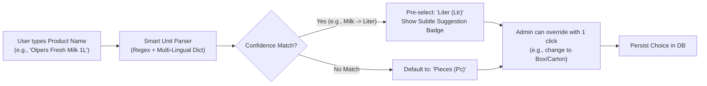
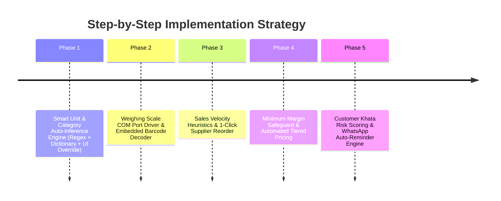

# Smart POS: Intelligent Features Roadmap & Architecture Plan

> **Document Type:** System Architecture & Feature Roadmap  
> **Status:** Drafted for Phased Execution (Priority-Ranked)  
> **Target Application:** Smart POS Retail & Wholesale Enterprise Engine  

---

## Executive Overview
The goal of this roadmap is to elevate **Smart POS** from a transactional point-of-sale into a proactive, intelligent retail assistant. Every smart feature is designed around two non-negotiable principles:
1. **Zero-Friction Automation:** The system infers context and suggests optimal defaults in real time (e.g. automatically choosing `Liter` for milk or `Piece` for tyres).
2. **Absolute User Sovereignty:** Every AI/heuristic suggestion is a default; the business owner/cashier always retains **100% override control** to pick or customize any option.

---

## Phase Breakdown & Priority Matrix

| Phase | Feature Name | Priority | Complexity | Core Value |
| :--- | :--- | :---: | :---: | :--- |
| **Phase 1** | **Smart Unit & Category Auto-Inference** | 🔴 **P0 (Immediate)** | Medium | Eliminates unit selection mistakes when creating products; instant time saver. |
| **Phase 2** | **Smart Weighing Scale & Embedded Barcode Engine** | 🟠 **P1 (High)** | Medium | Handles loose fractional items (fruits, meat, grains, liquids) with direct scale read. |
| **Phase 3** | **Predictive Stock Velocity & 1-Click Reorder** | 🟡 **P2 (Medium)** | Medium-High | Proactively prevents stockouts by forecasting depletion dates based on sales speed. |
| **Phase 4** | **Smart Profit Margin & Loss-Prevention Guard** | 🟡 **P2 (Medium)** | Low-Medium | Prevents selling below purchase cost or under allowed wholesale margins. |
| **Phase 5** | **Smart Khata Credit Health & Automated Chasing** | 🟢 **P3 (Next)** | Medium | Scores customer khata risk and sends automated WhatsApp payment reminders. |

---

## Detailed Specifications by Phase

### Phase 1: Smart Unit & Category Auto-Inference (P0 - Top Priority)



#### 1. Concept & User Experience
- When an admin types a product title in `AddProductScreen` or `AddProductDialog` (e.g., `Doodh`, `Fresh Milk`, `Ghee`, `Engine Oil`, `General Tyre 185/65`, `Cotton Fabric`, `Fauji Cement`):
  - The system analyzes the text in real-time (`onChanged` with a 250ms debounce).
  - It identifies key physical attributes, physical state (Liquid, Solid, Weighed, Measured, Packaged), and linguistic roots (in English, Urdu, and Roman Urdu).
  - It automatically pre-selects the appropriate base unit in the dropdown.
  - A subtle, elegant chip appears right beside the unit selector:
    `💡 Inferred: Liter (Liquid goods default) — Tap to change`.
  - **Override Logic:** If the admin manually clicks the dropdown and selects `Carton` or `Box`, a flag `_userManuallyOverrodeUnit = true` is set. The auto-inference engine immediately disables further auto-changes for that session, respecting the user's manual decision.

#### 2. Built-in Multi-Lingual Mapping Dictionary
```dart
static const Map<String, List<String>> unitInferenceRules = {
  'Ltr': [
    // English
    'milk', 'liquid', 'oil', 'petrol', 'diesel', 'juice', 'water', 'shampoo', 
    'syrup', 'vinegar', 'sauce', 'paint', 'coca cola', 'pepsi', 'drink',
    // Urdu / Roman Urdu
    'doodh', 'tel', 'tail', 'paani', 'sharbat', 'rooh afza', 'shir'
  ],
  'Kg': [
    // English
    'sugar', 'rice', 'flour', 'wheat', 'meat', 'beef', 'mutton', 'chicken', 
    'fish', 'apple', 'banana', 'potato', 'onion', 'vegetable', 'fruit', 'dry fruit',
    // Urdu / Roman Urdu
    'cheeni', 'chini', 'chawal', 'atta', 'gandum', 'gosht', 'sabzi', 'daal', 'dal'
  ],
  'Mtr': [
    // English
    'cloth', 'fabric', 'wire', 'cable', 'pipe', 'rope', 'curtain', 'tape',
    // Urdu / Roman Urdu
    'kapra', 'taar', 'tar', 'rassi', 'guz', 'latha', 'lawn'
  ],
  'Bag': [
    // English
    'cement', 'fertilizer', 'urea', 'feed', 'grain sack',
    // Urdu / Roman Urdu
    'bori', 'thaila', 'khaad'
  ],
  'Pc': [
    // English
    'tyre', 'tire', 'tube', 'battery', 'bulb', 'mobile', 'charger', 'mouse',
    'keyboard', 'shirt', 'pant', 'watch', 'filter', 'plug', 'bearing', 'shoe',
    // Urdu / Roman Urdu
    'tayar', 'pankha', 'joota', 'dabba'
  ],
};
```

---

### Phase 2: Smart Weighing Scale & Embedded Barcode Engine (P1)
1. **Direct Scale Reading (RS232/Serial/USB):**
   - Connect digital weighing scales directly (e.g., CAS, DIGI, Toledo).
   - In the POS Terminal, when a weighed product (`Kg`, `Ltr`, `Grams`) is selected, the system reads live gross weight automatically without manual typing.
2. **Standard Embedded Price/Weight Barcode Parsing (EAN-13 / GS1):**
   - Barcode format: `20 AAAAA WWWWW C` (where `20` = in-store fresh produce, `AAAAA` = Item code, `WWWWW` = Weight in grams or Price).
   - Cashier scans a butcher or vegetable sticker; the POS automatically extracts both item SKU and exact decimal weight.

---

### Phase 3: Predictive Stock Velocity & 1-Click Reorder (P2)
1. **Depletion Forecasting:**
   - Evaluates 7-day and 30-day moving average daily sales ($V_{daily}$).
   - Computes: $\text{Days Remaining} = \frac{\text{Current Stock}}{V_{daily}}$.
   - When $\text{Days Remaining} \le \text{Lead Time}$, a warning badge appears: `⚠️ Reorder in 3 days`.
2. **1-Click Purchase Order Generation:**
   - Automatically clusters all low-stock items by their preferred supplier.
   - Generates an official PO draft with suggested reorder quantities.

---

### Phase 4: Smart Profit Margin & Loss-Prevention Guard (P2)
1. **Below-Cost Warning:**
   - Real-time notification if a cashier enters an override discount that drops selling price below `purchase_price + tax`.
2. **Quantity Tier Breakpoints (Smart Volume Pricing):**
   - Buy 1-5 pieces = Normal Retail (`Rs 500`).
   - Buy 6-12 pieces = Tier 1 Wholesale (`Rs 460`).
   - Buy 1 Carton (24 pcs) = Master Case Price (`Rs 420`).
   - Cart calculates tiered discounts automatically based on total line quantity.

---

### Phase 5: Smart Khata Credit Risk & Automated WhatsApp Chasing (P3)
1. **Credit Health Score:**
   - **Score A (Excellent):** Customer settles bills within 15 days.
   - **Score B (Watchlist):** Settle between 15-35 days.
   - **Score C (Defaulter / Freeze):** Outstanding beyond 45 days. Auto-prompts POS to block additional credit sales until cleared.
2. **Automated WhatsApp Statement Dispatch:**
   - Sends formatted balance statement and polite payment reminder directly to customer's WhatsApp with one tap.

---

## Implementation Roadmap (Step-by-Step)



### Next Steps When Ready to Execute:
1. **Review & Confirm Phase 1:** Verify the dictionary keywords and ensure the UI/UX pattern matches preferences.
2. **Create Unit Inference Service:** Build `lib/services/smart_unit_service.dart`.
3. **Integrate into Product Forms:** Plug into `AddProductScreen` and `AddProductDialog`.
4. **Unit Tests:** Verify 100% accuracy on English, Urdu, and Roman Urdu keywords without false positives.

